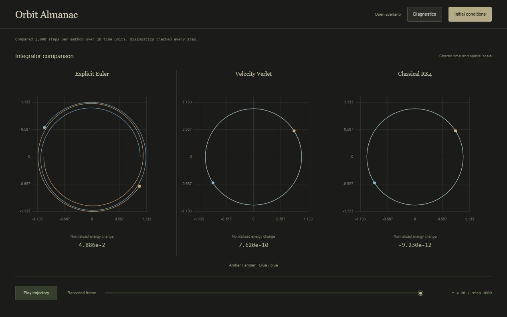

# Orbit Almanac

A numerical-dynamics workbench that compares explicit Euler, velocity Verlet, and classical RK4 under identical initial conditions. Inspect trajectories alongside energy drift, momentum, and center-of-mass motion.



## Interface

Euler, Verlet, and RK4 trajectories appear together with identical plot dimensions, spatial bounds, and recorded-frame playback. Each plot shows its current normalized energy change. Initial conditions open in a separate editor, while Diagnostics contains the energy chart, conservation ledger, model notes, and exports. Opening either panel pauses playback. On narrow screens the plots stack and share a sticky playback control.

## Run

Requires Python 3.10+. No runtime dependencies, accounts, or API keys.

```sh
python run.py --port 8000
```

Open http://127.0.0.1:8000/. Calculations run locally in a cancellable browser worker. Save a scenario before refreshing.

## Explore

- Start from a circular binary, a three-body encounter, or isolated linear motion.
- Edit masses, positions, velocities, softening, and time step for up to eight bodies.
- Compare three integrators with the same spatial scale; play or scrub recorded trajectories.
- Inspect signed energy change at a selected instant and logarithmic absolute drift across the run.
- Compare conservation peaks measured at every integration step, including steps omitted from display samples.
- Save/reopen scenarios and export all recorded trajectories as CSV or full diagnostic evidence as JSON.

[Example scenario](docs/example.json) uses two equal masses on an analytic circular orbit. At dt=0.02 over 20 time units, peak normalized energy drift is approximately 0.04886 for Euler, 8.297e-10 for Verlet, and 9.230e-12 for RK4. This is one scenario, not a universal ranking of integrators.

## Model and implementation

The model is two-dimensional, dimensionless, with G=1 and constant positive softening epsilon. Pair potential is `-mi*mj/sqrt(r²+epsilon²)`; acceleration uses `mj*(rj-ri)/(r²+epsilon²)^(3/2)`. Pair forces are accumulated symmetrically. Bodies pass through each other: there is no collision response, merging, relativity, or external force.

Euler uses starting velocities and accelerations. Verlet advances positions with starting acceleration and velocities with the average of starting and ending accelerations. RK4 applies four stages to the combined position/velocity system. All use a fixed step; there is no adaptive error controller.

Energy change is divided by initial kinetic energy plus absolute initial potential energy, or 1 for a zero-energy isolated state. Momentum error is the norm of the change in total momentum. Center-of-mass error compares against the initial center plus initial total momentum divided by total mass times elapsed time. Angular momentum is included in JSON samples. Diagnostics run every step; at most 501 frames per method are retained for display/export. The log chart floors absolute energy drift at 1e-16 for display only.

The worker accepts 1–20,000 steps, dt from 0.0001 to 0.1, softening 0.001–1, masses 0.001–100, initial coordinates within ±100, and initial velocities within ±20. Nonfinite states or position/velocity magnitudes over one million abort the comparison with an explicit error. A successful run still does not establish numerical accuracy: reduce the step and compare. Chaotic encounters can diverge substantially across integrators.

`core.js` contains pure validation, force, diagnostic, integration, and export functions. `worker.js` isolates computation. `app.js` manages editing, cancellable work, playback, and SVG plots. Input edits invalidate old results. Imported scenarios have a 100 KB limit. `run.py` serves only explicit static assets on loopback and rejects unexpected Host headers.

## Validation

Requires Node.js 22+ for JavaScript tests.

```sh
node --test
npm run check
python -m unittest discover -s tests -v
```

Eleven core tests cover analytic linear and circular motion, expected first/second/fourth convergence orders, force balance, finite-difference potential gradients, Verlet reversibility, momentum and center-of-mass conservation, overlapping softened bodies, numerical failure bounds, sample limits, and CSV output. One HTTP test covers assets, HEAD, hidden-file rejection, and Host validation. CI runs on Ubuntu with Node 22/24 and Windows with Node 24.

Manual browser checks covered playback, scrubbing, integrator switching, invalid mass rejection, smaller time steps, scenario round-trip, and downloads. An independent Python calculation verified energy and momentum for all 1,503 exported default samples and matched all 3,006 trajectory CSV rows. Final RK4 position error against the analytic circular solution was about 2.67e-9.
